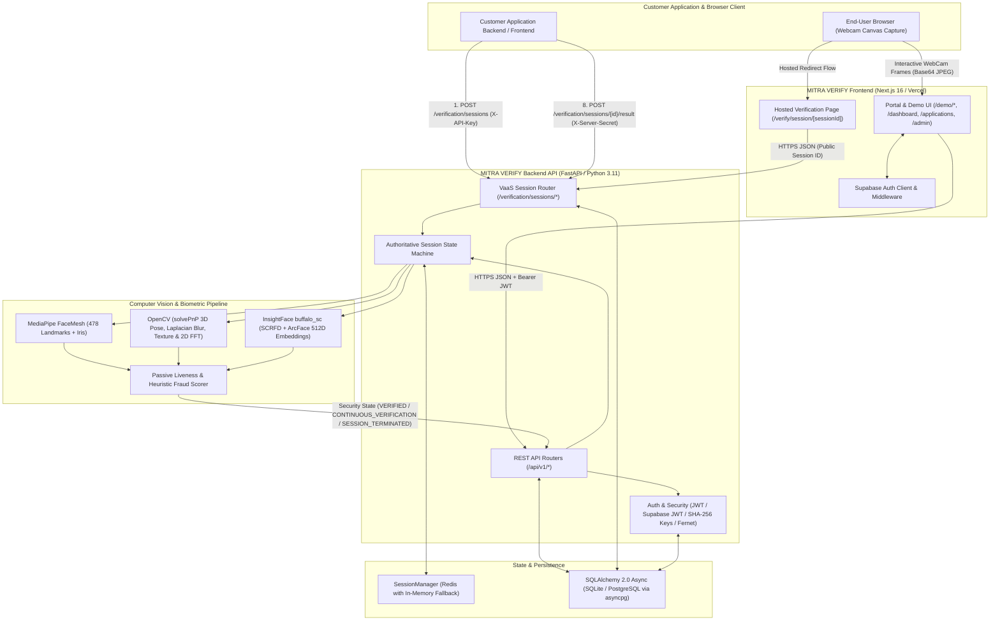
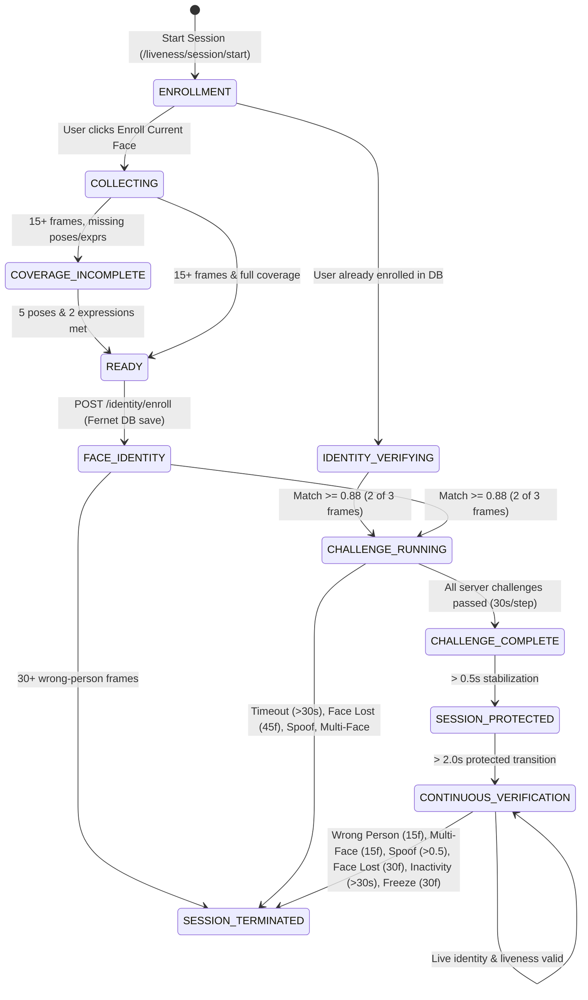

<div align="center">

# MITRA VERIFY

### Continuous Identity. Persistent Trust.

An AI-powered, API-first continuous identity verification, liveness detection, and session security platform built to verify that an authorized user remains the person operating a protected session.

[](https://mitraverify.vercel.app)
[](https://github.com/krishnavarshith21-co/mitra-vrify)
[](https://fastapi.tiangolo.com/)
[](https://nextjs.org/)
[](https://www.python.org/)
[](https://www.typescriptlang.org/)
[](https://developers.google.com/mediapipe)
[](https://github.com/deepinsight/insightface)
[](#license)

[Live Website](https://mitraverify.vercel.app) · [System Architecture](#system-architecture) · [API Documentation](#api-documentation) · [Quick Start](#installation-and-setup)

</div>

---

## Table of Contents

- [Executive Overview](#executive-overview)
- [The Problem](#the-problem)
- [Our Solution](#our-solution)
- [Core Features](#core-features)
- [System Architecture](#system-architecture)
- [How It Works](#how-it-works)
- [Technology Stack](#technology-stack)
- [Project Structure](#project-structure)
- [Installation and Setup](#installation-and-setup)
- [Environment Variables](#environment-variables)
- [API Documentation](#api-documentation)
- [Security Architecture](#security-architecture)
- [Screenshots and Product Preview](#screenshots-and-product-preview)
- [Use Cases](#use-cases)
- [Current Status and Roadmap](#current-status-and-roadmap)
- [Limitations](#limitations)
- [Contributing](#contributing)
- [License](#license)
- [Contact and Acknowledgements](#contact-and-acknowledgements)

> **Documentation Accuracy Note:** Every component, API endpoint, data model, threshold, and workflow documented in this README has been verified directly against the repository source code. Planned or partially implemented capabilities are explicitly labeled as such.

---

## Executive Overview

**MITRA VERIFY** is an API-first biometric identity assurance and session security platform composed of a **FastAPI** computer vision backend (`mitra-verify-backend`) and a **Next.js 16** developer portal, hosted verification UI, and interactive telemetry workbench (`mitra-verify`).

Traditional authentication answers one question once: *"Were valid credentials presented at login?"* MITRA VERIFY is designed to answer a harder, continuous question: *"Is a live, physically present, authorized human still operating this session right now?"*

For **engineering and security teams**, MITRA VERIFY provides REST APIs and a server-authoritative session state machine combining:

- **478-point facial landmark geometry and 3D head pose estimation** via MediaPipe FaceMesh and OpenCV `solvePnP`.
- **512-dimensional biometric face recognition** via InsightFace (`buffalo_sc` SCRFD detection + ArcFace recognition).
- **Passive liveness signals and randomized active challenge-response sequences** gated against anti-spoofing heuristics.
- **Continuous session monitoring** that tracks face presence, multiple-face intrusion, identity mismatch, and frozen camera feeds to emit deterministic terminal security states (`SESSION_TERMINATED`).
- **A Verification-as-a-Service (VaaS) redirect flow** enabling external applications to create short-lived verification sessions, redirect users to a hosted capture screen, and retrieve authoritative results server-to-server.

For **product leaders and compliance stakeholders**, MITRA VERIFY serves as an identity security layer for high-trust workflows—such as online proctoring, sensitive enterprise consoles, and step-up verification—where post-login identity substitution or presentation attacks undermine static session tokens.

---

## The Problem

Modern web and enterprise applications rely heavily on point-in-time authentication (passwords, OAuth, MFA, or bearer tokens). Once a session token is issued, the application assumes the original legitimate user remains at the keyboard until the token expires. This creates critical blind spots:

| Security Gap | Operational Risk |
| :--- | :--- |
| **Login-Only Verification** | Authentication occurs once at session start; subsequent actions are authorized solely by possession of a bearer token or cookie. |
| **Post-Login Identity Substitution** | An authorized user can authenticate and then hand the unlocked session to an unauthorized individual (e.g., proxy test-taking or shared workstation abuse). |
| **Unauthorized Session Access & Takeover** | Unattended terminals, shoulder-surfing, or secondary observers entering the workspace remain invisible to standard session management. |
| **Presentation & Replay Attacks** | Static 2D checks can be targeted with printed photographs, mobile screen replays, or frozen/looped virtual camera feeds. |
| **Lack of Continuous Assurance Signals** | Applications lack a unified security-state feed (`IDENTITY_VERIFYING`, `CHALLENGE_RUNNING`, `CONTINUOUS_VERIFICATION`, `SESSION_TERMINATED`) to enforce automatic session revocation. |

---

## Our Solution

MITRA VERIFY shifts verification from a single login event to a multi-stage, continuous pipeline backed by server-authoritative state tracking (`SESSION_CACHE` via Redis or in-memory fallback) and relational audit logging (`SQLAlchemy`).

### Implemented vs. Planned Capabilities

To maintain strict transparency, the table below distinguishes verified repository implementations from capabilities currently in progress or planned:

| Capability | Status | Implementation Details Verified in Repository |
| :--- | :---: | :--- |
| **Multi-Pose / Multi-Expression Enrollment** | **Implemented** | Collects 15 quality-gated frames across 5 head poses (`Front`, `Left 15`, `Right 15`, `Up`, `Down`) and 2 expressions (`Neutral`, `Smile`); stores L2-normalized 512D ArcFace templates encrypted with Fernet in `face_profiles`. |
| **Passive & Active Liveness Checks** | **Implemented** | EAR blink state machine, MAR mouth open/close, 3D PnP yaw/pitch/roll, eyebrow raise ratio, smile ratio, 2D FFT screen/moiré scoring, and skin texture variance. |
| **Randomized Server-Driven Challenges** | **Implemented** | `POST /api/v1/liveness/session/start` selects randomized challenges (`3–5` for `advanced`, `6–7` for `enterprise`) plus `FACE_CENTERED`, enforced server-side with a 30s per-challenge timeout. |
| **Continuous Monitoring & Termination** | **Implemented** | In the Enterprise demo pipeline (`/liveness/demo/process`), monitors face loss (`> 3.0s` or `30` frames), multiple faces, identity mismatch, spoof thresholds, camera freeze (30 identical MD5 frames), and 30s passive inactivity, transitioning to `SESSION_TERMINATED`. |
| **Customer App Enforcement (Redirect VaaS)** | **Implemented** | Client apps registered via `/api/v1/applications` create 10-min TTL sessions via `POST /api/v1/verification/sessions`, route users to `/verify/session/{sessionId}`, and query authoritative results via `POST /api/v1/verification/sessions/{sessionId}/result` using `X-Server-Secret`. |
| **Developer, Analytics & Admin Consoles** | **Implemented** | Full Next.js portals (`/dashboard`, `/developer`, `/applications`, `/admin`) backed by FastAPI analytics, API key management, user management, and audit/system log endpoints. |
| **Standalone `POST /api/v1/liveness/enterprise`** | **Partial** | Currently wraps `run_advanced_liveness` (single-frame); full continuous monitoring operates via `/liveness/session/start`, `/liveness/demo/process`, and `/identity/verify`. |
| **Hosted VaaS Identity Matching (`api3`)** | **Partial** | `verification/router.py` runs liveness/anti-spoof challenges on hosted sessions (`enrolled_signature=None`); pre-enrolled subject matching is wired in `/identity/verify` and `/demo/enterprise`. |
| **API Key Auth on `/liveness/*` & `/identity/*`** | **In Development** | `get_api_key_from_header` exists in `keys/router.py`, while `/liveness/{basic,advanced,enterprise}` and `/identity/*` currently enforce `Bearer` JWT (`get_current_user`). |
| **Rate-Limiting Middleware & Webhooks** | **Planned** | `rate_limit` column exists on `api_keys` and webhook status appears in dashboard UI, but active request throttling middleware and outbound webhook dispatch are not yet implemented. |
| **Publishable Client SDK Packages** | **Planned** | Code snippets in `/docs` and `/compare` reference `@mitraverify/sdk` and `mitraverify-sdk`; these packages are not yet present in the repository or published. |

---

## Core Features

### 1. Multi-Pose, Multi-Expression Biometric Enrollment
- **What it does:** Guides the user through capturing **15 quality-validated frames** spanning five viewing orientations (`Front`, `Left 15`, `Right 15`, `Up`, `Down`) and two facial expressions (`Neutral`, `Smile`), checking bounding-box centering, minimum face width (`> 25%` of frame), lighting variance, and pose bounds (`|yaw| <= 45°`, `|pitch| <= 20°`, `|roll| <= 20°`) before extracting 512-dimensional ArcFace embeddings.
- **Why it matters:** Single-frame frontal templates degrade rapidly when a user tilts their head or changes facial expression during an active session.
- **How it contributes to security:** Multi-sample templates (`face_profiles`) reduce false rejections during natural movement while raising resistance against static single-photo spoofs, and raw embedding values are never returned in HTTP enrollment responses.

### 2. Server-Authoritative Randomized Active Challenges
- **What it does:** Generates randomized challenge sequences on the backend (`FACE_CENTERED` followed by `BLINK_ONCE`, `BLINK_TWICE`, `HEAD_UP`, `HEAD_DOWN`, `HEAD_LEFT`, `HEAD_RIGHT`, `NOD_HEAD`, `OPEN_MOUTH`, `HEAD_ROTATION`, `EYEBROWS_UP`) and tracks consecutive hold frames (`CHALLENGE_HOLD_FRAMES = 5`) and baseline-calibrated displacements using 3D `solvePnP` angles, Eye Aspect Ratio (EAR), and Mouth Aspect Ratio (MAR).
- **Why it matters:** Client-side challenge checks can be bypassed in browser dev tools; ignoring frontend challenge overrides ensures the server dictates which gesture is currently active.
- **How it contributes to security:** Prevents pre-recorded video replay attacks by requiring specific real-time physical actions within a strict **30-second timeout window**, immediately failing timed-out challenges with `SPOOF_DETECTED`.

### 3. Passive Liveness & Heuristic Anti-Spoof Analysis
- **What it does:** Evaluates continuous frame streams for natural blink patterns, EAR variance (micro-saccade proxy), MAR muscle micro-movement, head micro-motion amplitude, MediaPipe 3D Z-depth variance, 2D Fast Fourier Transform (FFT) frequency ratios (moiré/screen detection), skin texture standard deviation, specular eye reflections, boundary Canny edge density (mask heuristic), forehead-to-cheek color delta (face-swap heuristic), and nose-tip teleportation/linear velocity anomalies.
- **Why it matters:** Active gestures alone are insufficient if an attacker replays segmented video clips or uses virtual camera overlays.
- **How it contributes to security:** Produces composite `spoof_score`, `fraud_detection`, and `enterprise_report.risk_score` signals that block challenge progression when a liveness violation is active and terminate sessions when risk thresholds are exceeded.

### 4. Continuous Session Monitoring & Security-State Machine
- **What it does:** Continuously evaluates incoming video frames post-authentication against the enrolled ArcFace template (`IDENTITY_MATCH_THRESHOLD = 0.88` with 2-of-3 temporal consistency) while monitoring for:
  - **Face Disappearance (`FACE_LOST` / `FACE_LOST_TIMEOUT`):** Terminates after `> 3.0s` missing face or `30` consecutive lost frames in continuous monitoring (`45` frames during challenges).
  - **Multiple-Face Presence (`MULTIPLE_FACES_DETECTED`):** Flags and terminates when `> 1` valid face persists (`5`–`15` frames depending on stage).
  - **Identity Mismatch / Takeover (`UNAUTHORIZED_PERSON`):** Increments `wrong_person_frames` outside challenge movement phases and terminates after `15` frames in `CONTINUOUS_VERIFICATION` (`30` frames in `FACE_IDENTITY`).
  - **Camera Freeze (`CAMERA_FREEZE`):** Hashes incoming frame payloads (`MD5`) and terminates if `30` identical frames arrive within the rolling window.
  - **Passive Inactivity (`PASSIVE_LIVENESS_TIMEOUT`):** Terminates if no blink, mouth movement, head rotation, or eyebrow raise occurs for `> 30.0s` during continuous verification.
- **Why it matters:** Catches post-login session handoffs, unauthorized onlookers, and stalled/frozen feeds without requiring users to re-enter passwords.
- **How it contributes to security:** Emits a terminal `SESSION_TERMINATED` state that cannot be revived by subsequent valid frames, logs the security event to `verification_logs`, and triggers automatic client sign-out in the Enterprise console (`/signin?reason=security_breach`).

### 5. Continuous Template Learning & Drift Detection
- **What it does:** On high-confidence matches (`similarity > 0.92`) in `POST /api/v1/identity/verify`, appends fresh 512D embeddings to multi-sample `FaceProfile` records (capped at 30 vectors FIFO), increments `template_version`, and computes cosine similarity against `original_embedding` (`< 0.85` flags `DRIFT_DETECTED`).
- **Why it matters:** Natural lighting and appearance shifts over time can erode single-snapshot matching accuracy, while unguarded template updates risk slow identity poisoning.
- **How it contributes to security:** Balances adaptive matching with a mathematical anchor (`original_embedding`) to detect long-term template drift.

### 6. Hosted Verification-as-a-Service (VaaS) Flow
- **What it does:** Allows developers to register applications (`/api/v1/applications`), receive a client `api_key` (`mvk_...`) and confidential `server_secret` (`mvs_...`), create 10-minute verification sessions (`POST /api/v1/verification/sessions`), redirect users to `/verify/session/{sessionId}`, and pull authoritative outcomes server-to-server (`POST /api/v1/verification/sessions/{sessionId}/result`).
- **Why it matters:** Decouples biometric camera capture and liveness evaluation from the customer application's frontend while preventing client-side result spoofing.
- **How it contributes to security:** Enforces `allowed_redirect_uris` validation, isolates end-user browser interactions from privileged result queries, and tracks per-application pass/fail telemetry.

### 7. Analytics, Audit Trails & Administration Portal
- **What it does:** Aggregates `VerificationLog` records across `Basic`, `Advanced`, and `Enterprise` tiers into time-series charts, threat summaries, and live activity tables (`/dashboard`), while providing role-gated user management, system logs, audit trails, and database health telemetry (`/admin`).
- **Why it matters:** Security teams require visibility into spoof attempts, verification latency, and key/user lifecycle actions.
- **How it contributes to security:** Records user registration, login, logout, API key creation/revocation, role changes, and status updates in `audit_logs`.

---

## System Architecture

MITRA VERIFY separates browser presentation and auth orchestration (Next.js 16 + Supabase) from stateless/session-cached computer vision processing and persistence (FastAPI + MediaPipe + InsightFace + SQLAlchemy + Redis).



---

## How It Works

MITRA VERIFY supports two primary execution flows verified in the codebase:

### Workflow 1: Enterprise Continuous Identity & Session Monitoring (`/demo/enterprise`)



1. **Session Initialization (`POST /api/v1/liveness/session/start`):** Creates a session in `SESSION_CACHE`, generates `FACE_CENTERED` plus `6–7` randomized enterprise challenges, and checks `face_profiles` for an existing Fernet-encrypted template.
2. **Quality-Gated Enrollment (`POST /api/v1/liveness/demo/process` + `POST /api/v1/identity/enroll`):** If unenrolled, the browser streams frames at ~10 FPS (`100ms` loop interval) until 15 valid frames are captured every 3 frames across `Front`, `Left 15`, `Right 15`, `Up`, `Down`, `Neutral`, and `Smile`. Once `enrollment_progress.state == "READY"`, the client calls `/identity/enroll`, which encrypts and stores the normalized 512D ArcFace template.
3. **Initial Identity Match:** Incoming frames are compared against the enrolled multi-sample template using top-3 cosine similarity (`IDENTITY_MATCH_THRESHOLD = 0.88`, requiring 2 of 3 consecutive matches).
4. **Active Challenge Execution:** The backend injects the active challenge from `SESSION_CACHE` (`current_challenge_index`), blocking progression if any liveness violation occurs (`BLUR_DETECTED`, `FACE_NOT_CENTERED`, `MULTIPLE_FACES_DETECTED`, `POSE_INVALID`, etc.) and enforcing a 30-second countdown per challenge.
5. **Continuous Verification & Enforcement:** Once challenges complete (`liveness_verified`), the session transitions through `CHALLENGE_COMPLETE` → `SESSION_PROTECTED` → `CONTINUOUS_VERIFICATION` (polling every `1500ms`). Any detected anomaly (`UNAUTHORIZED_PERSON`, `MULTIPLE_FACES_DETECTED`, `SPOOF_DETECTED`, `FACE_LOST`, `CAMERA_FREEZE`, `PASSIVE_LIVENESS_TIMEOUT`) transitions the session irreversibly to `SESSION_TERMINATED`, logs to `verification_logs`, and triggers frontend session termination (`/signin?reason=security_breach`).

### Workflow 2: Hosted Verification-as-a-Service (`/verify/session/[sessionId]`)

1. **Register Application:** Developer creates an application via `POST /api/v1/applications` (or `/applications` UI) and obtains `client_id`, `api_key` (`mvk_...`), and `server_secret` (`mvs_...`).
2. **Create Session:** Customer backend/client calls `POST /api/v1/verification/sessions` with `X-API-Key`, receiving `session_id` (`sess_...`), `verification_url` (`/verify/session/sess_...`), and 10-minute `expires_at`.
3. **Redirect User:** Customer app redirects the user to `<FRONTEND_URL>/verify/session/{session_id}`.
4. **Capture & Verify:** The hosted page loads metadata (`GET /verification/sessions/{id}`), starts the session (`POST /verification/sessions/{id}/start`), and streams webcam frames every `150ms` to `POST /verification/sessions/{id}/process`.
5. **Callback & Authoritative Check:** Upon completion (`VERIFIED` or `FAILED`), the hosted page redirects to `redirect_uri`. The customer backend calls `POST /api/v1/verification/sessions/{session_id}/result` with `X-Server-Secret` to securely verify the authoritative status before granting access.

---

## Technology Stack

All packages and versions below are verified directly from [`mitra-verify/package.json`](mitra-verify/package.json), [`mitra-verify-backend/requirements.txt`](mitra-verify-backend/requirements.txt), and infrastructure manifests.

| Layer | Technologies | Notes from Repository |
| :--- | :--- | :--- |
| **Frontend Framework** | Next.js `16.2.9`, React `19.2.4`, TypeScript `^5` | App Router with Turbopack (`next.config.ts`) |
| **UI, Styling & 3D** | Tailwind CSS `^4`, Radix UI primitives, Lucide React, Framer Motion `^12.41.0`, GSAP `^3.15.0`, Three.js `^0.184.0`, React Three Fiber `^9.6.1`, Drei, Postprocessing, Recharts `^3.8.1` | Interactive 3D hero/biometric overlays and analytics charts |
| **Frontend Data & Auth** | Axios `^1.17.0`, TanStack React Query `^5.101.0`, `@supabase/supabase-js` `^2.110.1`, `@supabase/ssr` `^0.12.0` | `next-auth` is listed in `package.json` but active auth uses Supabase SSR + Bearer JWTs |
| **Backend Framework** | FastAPI `>=0.111.0`, Uvicorn (`uvicorn[standard]`), Pydantic `>=2.7.1`, Pydantic Settings `>=2.2.1`, Python `3.11` | Async REST API (`app/main.py`) with HTTP security headers middleware |
| **Computer Vision & AI** | MediaPipe `0.10.14`, OpenCV Headless `>=4.9.0.80`, InsightFace `>=1.0.1` (`buffalo_sc`), ONNX Runtime `>=1.27.0`, NumPy `>=1.26.4`, SciPy `>=1.13.0`, Pillow `>=10.3.0` | MediaPipe 478-point FaceMesh + InsightFace SCRFD & ArcFace 512D (`CPUExecutionProvider`) |
| **Database & Migrations** | SQLAlchemy `>=2.0.30` (async), Alembic `>=1.13.1`, SQLite (`aiosqlite`), PostgreSQL (`asyncpg`, `psycopg2-binary`) | Auto-runs Alembic migrations on startup (`init_db()`); 15 ORM tables |
| **Session Cache** | Redis `>=5.0.0` (`redis`) | `SessionManager` uses Redis with automatic in-memory `fallback_cache` |
| **Security & Crypto** | `python-jose[cryptography]`, `bcrypt==3.2.2`, `cryptography` (Fernet), Python `hashlib` (SHA-256, MD5 for frame freeze check) | HS256/ES256/RS256 JWT decoding, bcrypt password hashing, SHA-256 key hashing |
| **Deployment & Tooling** | Vercel (`vercel.json`), Docker (`python:3.11-slim`), Render (`render.yaml`), Docker Compose (`postgres:15-alpine`, `redis:7-alpine`), Playwright (`^1.62.1`), Pytest | Backend Dockerfile pre-bakes `buffalo_sc` model and listens on port `7860` (`${PORT:-7860}`) |

---

## Project Structure

```text
mitra-vrify/
├── backend_config.json                 # Runtime backend URL config fetched by frontend in production
├── pyrightconfig.json                  # Static type-check configuration targeting backend venv
├── reset_database_production.py        # Utility script to call /api/v1/admin/reset-db
├── test_engine.py                      # Root CV engine test script
├── test_liveness.py                    # Root liveness test script
├── scripts/
│   └── start_backend.sh                # Starts local uvicorn server + ngrok tunnel
│
├── mitra-verify/                       # Frontend application (Next.js 16 + TypeScript)
│   ├── next.config.ts                  # Next.js / Turbopack configuration
│   ├── package.json                    # Frontend dependencies & scripts
│   ├── vercel.json                     # Vercel framework configuration
│   ├── public/
│   │   └── config.json                 # Local development fallback for backend apiBaseUrl
│   └── src/
│       ├── middleware.ts               # Supabase session refresh & route guard (/dashboard, /applications, /demo)
│       ├── context/AuthContext.tsx     # Auth state provider syncing Supabase session & /auth/me role
│       ├── lib/
│       │   ├── api.ts                  # Axios client, runtime GitHub/local config loader, API wrappers
│       │   ├── headPose.ts             # Head pose angle helpers
│       │   └── supabase.ts             # Supabase browser client
│       ├── components/                 # 3D scenes, dashboard charts, enterprise/advanced panels, debug HUD
│       └── app/
│           ├── page.tsx                # Landing page with 3D biometric core & pipeline overview
│           ├── demo/
│           │   ├── basic/page.tsx      # Fast Liveness live camera workbench
│           │   ├── advanced/page.tsx   # Anti-Spoof challenge live camera workbench
│           │   └── enterprise/page.tsx # Full Enrollment -> Identity -> Challenge -> Continuous Monitoring UI
│           ├── verify/session/[sessionId]/page.tsx  # Hosted VaaS end-user verification page
│           ├── applications/page.tsx   # Client application registration & key rotation portal
│           ├── developer/page.tsx      # Personal API key management portal (/api-keys redirects here)
│           ├── dashboard/page.tsx      # Analytics overview, API breakdown, & live activity feed
│           ├── admin/page.tsx          # Admin system telemetry, user directory, system & audit logs
│           ├── docs/                   # Public, integration, & protected enterprise documentation views
│           ├── compare/page.tsx        # Tier comparison UI
│           ├── signin/, signup/, auth/ # Authentication pages & OAuth callback
│           └── about/, contact/, ...   # Informational & placeholder compliance pages
│
└── mitra-verify-backend/               # Backend API & CV Engine (FastAPI + Python 3.11)
    ├── Dockerfile                      # Production container (python:3.11-slim + baked buffalo_sc model)
    ├── docker-compose.yml              # Local PostgreSQL 15 + Redis 7 services
    ├── render.yaml                     # Render Web Service deployment config
    ├── requirements.txt                # Python dependencies
    ├── alembic.ini                     # Alembic migration configuration
    ├── alembic/versions/               # 5 incremental schema migrations
    ├── tests/                          # Pytest unit & integration tests (enrollment, security, lifecycle, proxy)
    └── app/
        ├── main.py                     # FastAPI app, lifespan seeding, CV smoke test, CORS & security headers
        ├── core/
        │   ├── config.py               # Pydantic Settings & DB URL normalization (sqlite / postgresql+asyncpg)
        │   ├── database.py             # Async SQLAlchemy engine, pooling, & startup Alembic runner
        │   ├── logging.py              # Structured JSON logger
        │   └── security.py             # JWT creation/decoding, bcrypt, SHA-256 keys, Fernet template crypto
        ├── models/models.py            # 15 SQLAlchemy ORM models & enums
        ├── schemas/schemas.py          # Pydantic request/response schemas
        ├── services/
        │   ├── session_manager.py      # Redis-backed SessionManager + SessionProxy + in-memory fallback
        │   └── cv/mediapipe_engine.py  # MediaPipe FaceMesh, OpenCV pose/anti-spoof, InsightFace ArcFace engine
        └── api/v1/
            ├── auth/router.py          # Registration, login, JWT/Supabase JIT auth, logout
            ├── keys/router.py          # User API key CRUD & header helper
            ├── liveness/router.py      # Basic/Advanced/Enterprise liveness, /session/start, /demo/process, /debug_cv
            ├── identity/router.py      # /enroll, /verify, /enrolled GET/DELETE
            ├── applications/router.py  # Client application CRUD & credential rotation
            ├── verification/router.py  # Hosted VaaS session create, public metadata, start, process, & result
            ├── analytics/router.py     # Dashboard aggregations, overview, usage, threats, & telemetry
            └── admin/router.py         # Admin stats, user role/status management, logs, & DB reset
```

---

## Installation and Setup

### Prerequisites
- **Python 3.11+** (3.11 is used in [`mitra-verify-backend/Dockerfile`](mitra-verify-backend/Dockerfile))
- **Node.js 20+** and **npm** (`@types/node: ^20` in `package.json`)
- **Docker & Docker Compose** (optional, for PostgreSQL 15, Redis 7, or containerized backend execution)
- **Supabase Project** (required for frontend login/signup and SSR route protection)

### 1. Clone the Repository

```bash
git clone https://github.com/krishnavarshith21-co/mitra-vrify.git
cd mitra-vrify
```

### 2. Optional: Start PostgreSQL & Redis via Docker Compose

By default, the backend runs with zero external infrastructure using **SQLite** (`sqlite+aiosqlite:///./mitra_verify.db`) and an **in-memory session fallback** when Redis is unavailable. To use PostgreSQL and Redis locally:

```bash
cd mitra-verify-backend
docker compose up -d
```

### 3. Backend Setup & Startup (`mitra-verify-backend`)

```bash
cd mitra-verify-backend

# Create and activate virtual environment
python3 -m venv venv
source venv/bin/activate        # macOS / Linux
# venv\Scripts\activate         # Windows

# Install Python dependencies
pip install -r requirements.txt

# Configure environment variables (see Environment Variables section)
# Create mitra-verify-backend/.env with SECRET_KEY, TEMPLATE_ENCRYPTION_KEY, etc.

# Start the FastAPI server (Alembic migrations run automatically on startup via init_db())
uvicorn app.main:app --reload --host 0.0.0.0 --port 8000
```

Once running:
- **Interactive Swagger Docs:** `http://localhost:8000/docs`
- **ReDoc:** `http://localhost:8000/redoc`
- **Health Check:** `http://localhost:8000/health`
- **CV Engine Diagnostics:** `http://localhost:8000/api/v1/liveness/debug_cv`

> **Note:** On first use of Enterprise enrollment or verification, InsightFace downloads the `buffalo_sc` model weights if not already cached locally. When building via [`mitra-verify-backend/Dockerfile`](mitra-verify-backend/Dockerfile), `buffalo_sc` is downloaded at build time and the service listens on port `7860` (`${PORT:-7860}`).

### 4. Frontend Setup & Startup (`mitra-verify`)

```bash
cd mitra-verify

# Install dependencies
npm install

# Configure mitra-verify/.env.local (see Environment Variables section)
# Also update mitra-verify/public/config.json to point to your local backend:
# { "apiBaseUrl": "http://localhost:8000" }

# Start development server (runs on port 3000)
npm run dev
```

> **Important Runtime Configuration Detail:** In [`mitra-verify/src/lib/api.ts`](mitra-verify/src/lib/api.ts), `getApiBaseUrl()` fetches [`backend_config.json`](backend_config.json) from the GitHub repository first and falls back to `mitra-verify/public/config.json` only when `NODE_ENV !== 'production'` and the GitHub fetch fails. If testing locally against `http://localhost:8000` while online, be aware that `getApiBaseUrl()` prioritizes the remote `backend_config.json` URL unless updated for your environment.

#### Production Frontend Build & Lint

```bash
cd mitra-verify
npm run lint
npm run build
npm run start
```

### 5. Running Backend Tests

```bash
cd mitra-verify-backend
source venv/bin/activate
python -m pytest tests/ -v
```

*(Note: Some test assertions in `tests/` reflect earlier iterations of the challenge count or response schema; inspect individual test files before asserting CI gates.)*

---

## Environment Variables

### Backend (`mitra-verify-backend/.env`)

| Variable | Required | Default in Code | Description |
| :--- | :---: | :--- | :--- |
| `SECRET_KEY` | **Yes (Prod)** | Hardcoded dev fallback in `config.py` | Secret key for signing internal HS256 access and refresh JWTs. **Must be overridden in production.** |
| `ALGORITHM` | No | `HS256` | JWT signing algorithm. |
| `ACCESS_TOKEN_EXPIRE_MINUTES` | No | `60` | Access token lifetime in minutes. |
| `REFRESH_TOKEN_EXPIRE_DAYS` | No | `30` | Refresh token lifetime in days. |
| `DATABASE_URL` | No | `sqlite+aiosqlite:///./mitra_verify.db` | Database connection URI. `postgres://` and `postgresql://` prefixes are automatically converted to `postgresql+asyncpg://`. |
| `DATABASE_URL_ASYNC` | No | `None` | Optional explicit async SQLAlchemy URL override. |
| `SUPABASE_JWT_SECRET` | **Yes (Prod)** | `"your-supabase-jwt-secret"` | Secret/key used to verify Supabase JWTs (`HS256`, `ES256`, `RS256`). **Warning:** If left at default, `decode_supabase_token` falls back to unverified claim extraction. |
| `TEMPLATE_ENCRYPTION_KEY` | **Yes (Prod)** | Hardcoded fallback in `security.py` | URL-safe base64 32-byte Fernet key used to encrypt/decrypt `FaceProfile.embedding_vector`. |
| `REDIS_URL` | No | `redis://localhost:6379/0` | Redis connection URL for `SessionManager`; falls back to in-memory dictionary if unavailable. |
| `CORS_ORIGINS` | No | `http://localhost:3005,...,*` | Comma-separated list of allowed CORS origins. Restrict `*` in production. |
| `ENVIRONMENT` | No | `development` | `development` enables SQLAlchemy `echo=True`; set to `production` when deploying. |
| `PORT` | No | `7860` (Docker) | Port binding used by the container `CMD`. |

Example `mitra-verify-backend/.env` template (never commit real secrets):

```dotenv
ENVIRONMENT=development
SECRET_KEY=replace-with-a-cryptographically-random-secret
ALGORITHM=HS256
ACCESS_TOKEN_EXPIRE_MINUTES=60
REFRESH_TOKEN_EXPIRE_DAYS=30
DATABASE_URL=sqlite+aiosqlite:///./mitra_verify.db
SUPABASE_JWT_SECRET=replace-with-your-supabase-jwt-secret
TEMPLATE_ENCRYPTION_KEY=replace-with-fernet-base64-key
REDIS_URL=redis://localhost:6379/0
CORS_ORIGINS=http://localhost:3000,https://mitraverify.vercel.app
```

### Frontend (`mitra-verify/.env.local`)

| Variable | Required | Default | Description |
| :--- | :---: | :--- | :--- |
| `NEXT_PUBLIC_SUPABASE_URL` | **Yes** | `""` | Your Supabase project URL (used by `src/lib/supabase.ts` and `src/middleware.ts`). |
| `NEXT_PUBLIC_SUPABASE_ANON_KEY` | **Yes** | `""` | Your Supabase anonymous/public key for client auth and SSR middleware. |
| `NEXT_PUBLIC_API_URL` | No | `""` | Exposed in `next.config.ts`; note that `src/lib/api.ts` resolves the backend URL via `backend_config.json` / `public/config.json`. |

Example `mitra-verify/.env.local` template:

```dotenv
NEXT_PUBLIC_SUPABASE_URL=https://your-project-ref.supabase.co
NEXT_PUBLIC_SUPABASE_ANON_KEY=your-supabase-anon-key
NEXT_PUBLIC_API_URL=http://localhost:8000
```

---

## API Documentation

Base API prefix: `/api/v1` (except root health/telemetry probes).

### Authentication Mechanisms in the Current Codebase
- **User / Portal JWT (`Authorization: Bearer <token>`):** Required by `/auth/me`, `/auth/logout`, `/keys/*`, `/applications/*`, `/analytics/*`, `/admin/*`, `/liveness/{basic,advanced,enterprise}`, and `/identity/*`. Accepts either internal tokens from `POST /api/v1/auth/login` or Supabase access tokens.
- **Client Application Key (`X-API-Key: mvk_...`):** Required by `POST /api/v1/verification/sessions`.
- **Client Server Secret (`X-Server-Secret: mvs_...`):** Required by `POST /api/v1/verification/sessions/{session_id}/result`.
- **Public / Session-Tokenized:** `GET /health`, `GET /api/v1/liveness/debug_cv`, `POST /api/v1/liveness/demo/process`, `GET /api/v1/verification/sessions/{id}`, `/start`, and `/process`.

---

### 1. System & Diagnostics

| Method | Endpoint | Auth | Purpose |
| :--- | :--- | :--- | :--- |
| `GET` | `/` | None | Returns API product metadata and endpoint directory. |
| `GET` | `/health`, `/api/health`, `/api/v1/health` | None | Liveness probe returning `{"status": "ok", "version": "1.0"}`. |
| `GET` | `/telemetry`, `/api/v1/telemetry` | None | Telemetry synchronization check and UTC timestamp. |
| `GET` | `/api/v1/liveness/debug_cv` | None | Inspects OpenCV, MediaPipe, InsightFace, ONNX Runtime, PIL, SciPy, NumPy availability and runs a blank-image FaceMesh smoke test. |

---

### 2. Authentication (`/api/v1/auth`)

#### `POST /api/v1/auth/register`
Creates a local user account with `role="user"` and logs the event to `audit_logs`.
- **Body (`UserRegister`):** `email` (EmailStr, required), `password` (string, required), `full_name` (string, optional).
- **Responses:** `201 Created` (`UserOut`) · `400 Bad Request` (`Email already registered`).

#### `POST /api/v1/auth/login`
Authenticates email/password via `bcrypt` and returns JWT tokens.
- **Body (`UserLogin`):** `email` (EmailStr, required), `password` (string, required).
- **Response (`200 OK`):**
  ```json
  {
    "access_token": "<jwt>",
    "refresh_token": "<jwt>",
    "token_type": "bearer"
  }
  ```
- **Errors:** `401 Unauthorized` (`Invalid email or password`).

#### `GET /api/v1/auth/me` & `POST /api/v1/auth/logout`
- `GET /api/v1/auth/me`: Returns `UserOut` for the active internal or Supabase JWT (with Just-In-Time user provisioning for Supabase users).
- `POST /api/v1/auth/logout`: Marks the active `Session` record inactive and logs an audit entry.

---

### 3. API Key Management (`/api/v1/keys`)

| Method | Endpoint | Auth | Purpose |
| :--- | :--- | :--- | :--- |
| `POST` | `/api/v1/keys` | Bearer JWT | Creates a SHA-256 hashed key (`api_type`: `basic` \| `advanced` \| `enterprise`). Returns `plaintext` once (`201 Created`). |
| `GET` | `/api/v1/keys` | Bearer JWT | Lists active/revoked keys for the authenticated user (prefix only). |
| `DELETE` | `/api/v1/keys/{key_id}` | Bearer JWT | Revokes a key (`is_active = false`). Returns `404` if not found. |

---

### 4. Liveness & Continuous Session Pipeline (`/api/v1/liveness`)

#### `POST /api/v1/liveness/basic`
- **Auth:** `Authorization: Bearer <token>`
- **Purpose:** Single-frame passive face presence, landmark geometry, blink/mouth/head/smile checks, and spoof-risk evaluation.
- **Request Body (`BasicLivenessRequest`):**
  ```json
  {
    "image": "data:image/jpeg;base64,/9j/4AAQSkZJRg...",
    "session_id": "optional-session-id"
  }
  ```
- **Example Request:**
  ```bash
  curl -X POST http://localhost:8000/api/v1/liveness/basic \
    -H "Authorization: Bearer <ACCESS_TOKEN>" \
    -H "Content-Type: application/json" \
    -d '{"image": "data:image/jpeg;base64,<BASE64_FRAME>"}'
  ```
- **Example Response (`200 OK`):**
  ```json
  {
    "session_id": "550e8400-e29b-41d4-a716-446655440000",
    "result": "pass",
    "confidence": 0.9412,
    "processing_time": 42.18,
    "liveness_score": 0.85,
    "checks": {
      "face_present": true,
      "blink_detected": false,
      "mouth_movement": false,
      "head_rotation": false,
      "smile_detected": true
    },
    "timestamp": "2026-01-15T10:30:00Z"
  }
  ```
- **Errors:** `401 Unauthorized` if bearer token is missing/invalid; returns `"result": "fail"` if no face is detected or thresholds fail, or `"result": "error"` if CV dependencies are unavailable or image decoding fails.

#### `POST /api/v1/liveness/advanced`
- **Auth:** `Authorization: Bearer <token>`
- **Purpose:** Performs skin texture variance, 2D FFT screen/moiré frequency analysis, deepfake risk estimation, and optional single-frame challenge check.
- **Request Body (`AdvancedLivenessRequest`):** `image` (required), `challenge_type` (optional, e.g., `blink_twice`, `turn_left`, `turn_right`, `open_mouth`), `session_id` (optional).
- **Response (`200 OK`):** Includes `session_id`, `result` (`pass` \| `fail` \| `spoof` \| `error`), `confidence`, `processing_time`, `spoof_score`, `deepfake_risk`, `challenge_result`, `checks`, `timestamp`.

#### `POST /api/v1/liveness/enterprise`
- **Auth:** `Authorization: Bearer <token>`
- **Status:** Partial wrapper — currently calls `run_advanced_liveness` and logs `api_type="enterprise"`. For full multi-stage enrollment, identity matching, and continuous monitoring, use the session endpoints below.

#### `POST /api/v1/liveness/session/start`
- **Auth:** Optional `Authorization: Bearer <token>` (required to load existing `FaceProfile` for `enterprise` sessions).
- **Purpose:** Initializes `SESSION_CACHE` state and generates a randomized server-side challenge sequence (`FACE_CENTERED` + 3 fixed challenges for `basic`, 3–5 random for `advanced`, 6–7 random for `enterprise`).
- **Request Body (`SessionStartRequest`):**
  ```json
  {
    "api_type": "enterprise",
    "session_id": null
  }
  ```
- **Example Response (`200 OK`):**
  ```json
  {
    "session_id": "9a38f828-e5cc-44aa-9c59-bf8e4113e1f0",
    "challenges": [
      {
        "id": "FACE_CENTERED",
        "label": "1. Face Centered",
        "instruction": "Center your face inside the guides",
        "icon": "👤"
      },
      {
        "id": "HEAD_LEFT",
        "label": "2. Turn Head Left",
        "instruction": "Turn your head to the left",
        "icon": "👈"
      }
    ]
  }
  ```

#### `POST /api/v1/liveness/demo/process`
- **Auth:** None (relies on `session_id` initialized via `/session/start`).
- **Purpose:** Authoritative frame-by-frame processing endpoint for Basic, Advanced, and Enterprise continuous sessions.
- **Request Body (`DemoProcessRequest`):**
  ```json
  {
    "image": "data:image/jpeg;base64,<BASE64_FRAME>",
    "frame_id": "12",
    "session_id": "9a38f828-e5cc-44aa-9c59-bf8e4113e1f0",
    "challenge_type": "HEAD_LEFT",
    "api_type": "enterprise",
    "action": "start_enrollment_capture"
  }
  ```
- **Behavior & Response Fields:**
  - Server injects its own `active_challenge` from `SESSION_CACHE` (`current_challenge_index`), returning `time_remaining` (30s window), `sequence_advanced`, `challenge_passed`, `liveness_status` (`ok` or violation reason), and `liveness_warning`.
  - When `api_type == "enterprise"`, returns `enrollment_progress`, `similarity_score`, `identity_match`, `enrolled_matched`, `passive_liveness`, `fraud_detection`, `landmark_geometry`, `pose_validation`, `eye_tracking`, `face_tracking`, `anti_spoof_details`, `telemetry`, and `enterprise_report`.
  - Terminal failures (`MULTIPLE_FACES_DETECTED`, `SPOOF_DETECTED`, `UNAUTHORIZED_PERSON`, `FACE_LOST`, `FACE_LOST_TIMEOUT`, `CAMERA_FREEZE`, etc.) transition `status` to `"SESSION_TERMINATED"` with `"result": "fail"` and persist to `verification_logs` if an authenticated user owns the session.

#### `POST /api/v1/liveness/demo/log_event`
- **Auth:** `Authorization: Bearer <token>`
- **Purpose:** Persists client-triggered terminal/security events (`session_id`, `event_type`, `api_type`) into `verification_logs` if the session has not already been logged.

---

### 5. Identity Enrollment & Matching (`/api/v1/identity`)

All endpoints require `Authorization: Bearer <token>`.

#### `POST /api/v1/identity/enroll`
- **Purpose:** Validates face presence, single face, `>= 468` landmarks, centering, size (`bbox_w >= 0.25`), and lighting; when `session_id` is present, requires `>= 15` valid frames plus pose coverage (`Front`, `Left 15`, `Right 15`, `Up`, `Down`) and expression coverage (`Neutral`, `Smile`). Stores Fernet-encrypted 512D ArcFace template in `face_profiles` and transitions `SESSION_CACHE` stage to `IDENTITY_VERIFYING`.
- **Request Body (`IdentityEnrollRequest`):** `image` (required), `subject_id` (optional, defaults to current user), `session_id` (optional).
- **Success Response (`200 OK`):**
  ```json
  {
    "status": "success",
    "message": "Enrollment successful. Quality: 88/100",
    "user_id": "4b21...",
    "created_at": "2026-01-15T10:32:00Z"
  }
  ```
- **Structured Incomplete Session Responses (`200 OK` with `success: false`):** `SESSION_EXPIRED`, `ENROLLMENT_NOT_READY`, `INSUFFICIENT_POSE_COVERAGE`, `INSUFFICIENT_EXPRESSION_COVERAGE`.
- **HTTP Errors:** `400 Bad Request` (invalid image, no face, multiple faces, incomplete landmarks, face too small/uncentered, lighting too dark) · `500 Internal Server Error` (CV engine unavailable or DB error).

#### `POST /api/v1/identity/verify`
- **Purpose:** Decrypts the enrolled `FaceProfile` for `subject_id` (or current user), computes cosine similarity against a fresh 512D ArcFace embedding, updates `template_version` via continuous template learning if `similarity > 0.92`, evaluates drift against `original_embedding`, and logs to `verification_logs`.
- **Request Body (`IdentityVerifyRequest`):** `image` (required), `subject_id` (optional), `session_id` (optional).
- **Example Response (`200 OK`):**
  ```json
  {
    "session_id": "31bfa2a9-c0c8-47a2-9852-c8a7b6a12df5",
    "result": "IDENTITY_MATCH_SUCCESS",
    "confidence": 0.974,
    "processing_time": 118.4,
    "identity": {
      "identity_match": true,
      "similarity": 0.9312,
      "distance": 0.3709,
      "confidence": 0.974,
      "reason": "PASS",
      "subject_id": "4b21...",
      "template_version": 2,
      "drift_status": "STABLE"
    },
    "checks": {
      "face_present": true,
      "blink_detected": false,
      "mouth_movement": false,
      "head_rotation": false,
      "eyebrow_raised": false
    },
    "continuous_session": null,
    "timestamp": "2026-01-15T10:35:00Z"
  }
  ```
- **Errors:** `401 Unauthorized` · `500 Internal Server Error` (`Corrupted enrolled template format`).

#### `GET /api/v1/identity/enrolled` & `DELETE /api/v1/identity/enrolled`
- `GET`: Returns `{"enrolled": true, "created_at": "..."}` or `{"enrolled": false}`.
- `DELETE`: Deletes the user's `FaceProfile` row and removes any matching `SESSION_CACHE` entries (`{"success": true}`).

---

### 6. Client Applications (`/api/v1/applications`)

All endpoints require `Authorization: Bearer <token>`.

| Method | Endpoint | Purpose |
| :--- | :--- | :--- |
| `POST` | `/api/v1/applications` | Registers a `ClientApplication` (`name`, `api_level`: `api1`\|`api2`\|`api3`, `allowed_redirect_uris`). Returns `client_id` (`app_...`), `api_key` (`mvk_...`), and `server_secret` (`mvs_...`) once (`201 Created`). |
| `GET` | `/api/v1/applications` | Lists applications owned by the authenticated user. |
| `GET` | `/api/v1/applications/{app_id}` | Gets application metadata (`404` if not found). |
| `PUT` | `/api/v1/applications/{app_id}` | Updates `name`, `api_level`, or `allowed_redirect_uris`. |
| `DELETE` | `/api/v1/applications/{app_id}` | Deactivates application (`is_active = false`). |
| `POST` | `/api/v1/applications/{app_id}/rotate-keys` | Issues new `mvk_` API key and `mvs_` server secret, invalidating old credentials immediately. |

---

### 7. Hosted Verification Sessions (`/api/v1/verification`)

#### `POST /api/v1/verification/sessions`
- **Auth:** `X-API-Key: <client_api_key>` (`mvk_...`)
- **Purpose:** Creates a 10-minute TTL verification session for a client application.
- **Request Body (`VerificationSessionCreate`):**
  ```json
  {
    "application_id": "app_1234567890abcdef",
    "api_level": "api2",
    "redirect_uri": "https://your-app.com/callback"
  }
  ```
- **Response (`201 Created`):**
  ```json
  {
    "session_id": "sess_e3c1a9...",
    "verification_url": "/verify/session/sess_e3c1a9...",
    "expires_at": "2026-01-15T10:40:00Z"
  }
  ```
- **Errors:** `400 Bad Request` (`api_level` invalid or `redirect_uri` not in `allowed_redirect_uris`) · `401 Unauthorized` (invalid/revoked `X-API-Key`) · `403 Forbidden` (`application_id` mismatch).

#### `GET /api/v1/verification/sessions/{session_id}`
- **Auth:** None (public metadata for hosted UI).
- **Response (`200 OK`):** `session_id`, `api_level`, `application_name`, `status` (`CREATED`\|`IN_PROGRESS`\|`VERIFIED`\|`FAILED`\|`EXPIRED`\|`CANCELLED`), `expires_at`. Returns `404` if unknown.

#### `POST /api/v1/verification/sessions/{session_id}/start`
- **Auth:** None.
- **Purpose:** Transitions `CREATED`/`IN_PROGRESS` session to `IN_PROGRESS` and initializes `SESSION_CACHE` challenges.
- **Errors:** `404` (not found) · `409` (terminal status) · `410` (expired).

#### `POST /api/v1/verification/sessions/{session_id}/process`
- **Auth:** None.
- **Body (`VerificationFrameRequest`):** `image` (base64), optional `frame_id`, optional `challenge_type`.
- **Purpose:** Evaluates frame via `process_demo_frame`, updates `VerificationSession` (`VERIFIED` or `FAILED` with `failure_reason`), updates `ClientApplication` counters, and sets `verification_complete`, `verification_passed`, `redirect_uri`.
- **Errors:** `400` (not started) · `404` (not found) · `409` (not in progress) · `410` (expired).

#### `POST /api/v1/verification/sessions/{session_id}/result`
- **Auth:** `X-Server-Secret: <server_secret>` (`mvs_...`)
- **Purpose:** Server-to-server authoritative result retrieval. Marks `result_retrieved = true`.
- **Response (`200 OK`):**
  ```json
  {
    "session_id": "sess_e3c1a9...",
    "status": "VERIFIED",
    "api_level": "api2",
    "confidence": 0.96,
    "failure_reason": null,
    "verified_at": "2026-01-15T10:33:12Z",
    "created_at": "2026-01-15T10:30:00Z"
  }
  ```
- **Errors:** `202 Accepted` (verification still in progress) · `401 Unauthorized` (invalid `X-Server-Secret`) · `404 Not Found` (session not found or belongs to another app).

---

### 8. Analytics & Administration (`/api/v1/analytics` & `/api/v1/admin`)

| Method | Endpoint | Auth | Notes |
| :--- | :--- | :--- | :--- |
| `GET` | `/api/v1/analytics/overview` | Bearer JWT | Aggregated request, pass/fail, spoof, deepfake, identity match, and latency stats. |
| `GET` | `/api/v1/analytics/dashboard?timeframe=24h` | Bearer JWT | Executive overview, summary, per-tier breakdown, timeline, threats, and 50 recent events (`24h`\|`7d`\|`30d`\|`90d`). |
| `GET` | `/api/v1/analytics/usage` | Bearer JWT | Time-ordered verification results over `days` (default `30`). |
| `GET` | `/api/v1/analytics/threats` | Bearer JWT | Up to 50 recent non-pass `VerificationLog` records. |
| `GET` | `/api/v1/analytics/events` | Bearer JWT | Recent verification events (`limit`, default `50`). |
| `POST` | `/api/v1/analytics/events` | Bearer JWT | Stub endpoint acknowledging client event payloads without DB writes. |
| `GET` | `/api/v1/analytics/realtime` | Bearer JWT | Static placeholder metrics (`active_sessions: 1`, `cpu_usage_percent: 12.5`, etc.). |
| `GET` | `/api/v1/admin/stats` | Admin JWT | Global user, key, verification counts, DB file size, and `psutil` CPU/memory stats. |
| `GET` | `/api/v1/admin/users` | Admin JWT | Lists all user accounts. |
| `PUT` | `/api/v1/admin/users/{user_id}/role` | Admin JWT | Updates user role (`user`\|`admin`\|`enterprise`); blocks self-downgrade. |
| `PUT` | `/api/v1/admin/users/{user_id}/status` | Admin JWT | Activates/deactivates user account; blocks self-deactivation. |
| `GET` / `DELETE` | `/api/v1/admin/logs/system` | Admin JWT | Queries (`level`, `limit`) or clears `system_logs`. |
| `GET` / `DELETE` | `/api/v1/admin/logs/audit` | Admin JWT | Queries or clears `audit_logs`. |
| `POST` | `/api/v1/admin/reset-db` | Admin JWT | Purges operational tables while retaining `admin@mitraverify.com`. |

---

## Security Architecture

### Implemented Security Controls
- **Credential & Key Hashing:** Passwords are hashed using `bcrypt` (truncated to 72 bytes). Both developer `ApiKey` secrets (`mv_basic_`, `mv_adv_`, `mv_ent_`) and `ClientApplication` credentials (`mvk_`, `mvs_`) are stored strictly as **SHA-256 hashes**; plaintext values are returned only once at creation or rotation.
- **Biometric Template Encryption:** `FaceProfile.embedding_vector` is encrypted at rest using **Fernet** symmetric authenticated encryption (`cryptography.fernet`) prior to database persistence, and raw embeddings are omitted from API responses.
- **Server-Side Challenge Integrity:** In `/liveness/demo/process`, the backend overrides client-supplied `challenge_type` values with its `SESSION_CACHE` state (`current_challenge_index`) and blocks challenge advancement whenever any liveness violation is active.
- **Server-to-Server Result Separation:** Hosted VaaS sessions require `X-Server-Secret` (`mvs_...`) to query authoritative session outcomes, preventing untrusted browser tampering, and validate `redirect_uri` against each application's `allowed_redirect_uris`.
- **HTTP Hardening Headers:** FastAPI middleware attaches `X-Content-Type-Options: nosniff`, `X-Frame-Options: DENY`, `X-XSS-Protection: 1; mode=block`, `Strict-Transport-Security`, and `Content-Security-Policy: default-src 'self'`.
- **Admin Privilege Guard & Audit Logging:** Administrative routes enforce `role == "admin"`, prevent self-demotion/self-deactivation, and record key, login, and role operations in `audit_logs`.

### Security Gaps & Planned Improvements
The following differences between marketing copy in some frontend UI pages and the actual backend codebase must be addressed before production enterprise deployment:
1. **Default Secrets & Unverified JWT Fallback:** `config.py` and `security.py` define hardcoded fallback values for `SECRET_KEY`, `TEMPLATE_ENCRYPTION_KEY`, and `SUPABASE_JWT_SECRET`. When `SUPABASE_JWT_SECRET` retains its placeholder string, `decode_supabase_token` uses `jwt.get_unverified_claims(token)` without cryptographic signature verification. Production deployments **must** set strong, unique secrets.
2. **Unencrypted Backup Column:** While `FaceProfile.embedding_vector` is Fernet-encrypted, `identity/router.py` still writes the raw multi-sample list to `FaceProfile.original_embedding` for drift comparisons.
3. **Seeded Default Admin:** `app/main.py` seeds `admin@mitraverify.com` with password `admin123` on startup if not present—this account should be rotated or removed immediately in any live environment.
4. **Raw Frame Transmission & Debug Files:** Contrary to "edge-only / zero image transmission" text in UI marketing components, the browser currently transmits base64 JPEG frames to the FastAPI backend. Additionally, `mediapipe_engine.py` writes one-time diagnostic images (`/tmp/debug_frame.jpg`, `/tmp/debug_landmarks.jpg`) to local temp storage.
5. **Rate Limiting & Compliance:** `api_keys.rate_limit` is stored in the database schema, but request-throttling middleware is not yet enforced; badges such as SOC2, ISO27001, or GDPR in footer UI components are aspirational and not backed by certifications in this repository.

---

## Screenshots and Product Preview

- **Live Deployment:** [https://mitraverify.vercel.app](https://mitraverify.vercel.app)
- **Repository Media Audit:** No genuine application UI screenshots are currently committed in this repository. (The file [`mitra-verify-backend/screenshot_test.png`](mitra-verify-backend/screenshot_test.png) is a test capture of an ngrok domain dashboard, and `.jpg` files in `mitra-verify-backend/` are CV test fixtures.)
- **Preview Recommendation:** Visit the live deployment or start the local frontend (`npm run dev`) to explore the 3D landing scene, `/demo/basic`, `/demo/advanced`, `/demo/enterprise`, `/applications`, `/dashboard`, and `/admin` views.

---

## Use Cases

| Domain | How MITRA VERIFY Applies |
| :--- | :--- |
| **Online Examination & Assessment Integrity** | Enrolls the candidate's face prior to an exam, executes randomized head/blink/mouth liveness challenges, and continuously flags face disappearance, multiple faces, or person substitution during the test session. |
| **Enterprise Workforce Session Assurance** | Protects internal admin portals and sensitive dashboards against unattended-screen hijacking or credential sharing via continuous background verification (`CONTINUOUS_VERIFICATION`). |
| **Step-Up Authentication for Sensitive Workflows** | Integrates via the Hosted VaaS session flow (`/api/v1/verification/sessions`) before wire transfers, credential changes, or high-privilege administrative actions. |
| **Remote Identity Assurance & Onboarding** | Combines multi-pose/multi-expression enrollment with anti-spoof challenge-response to reduce printed-photo and screen-replay attacks during remote verification. |

---

## Current Status and Roadmap

### Implemented
- FastAPI async backend with SQLAlchemy 2.0 ORM (15 tables) and Alembic migrations (`sqlite` & `postgresql+asyncpg`).
- MediaPipe 478-landmark FaceMesh + OpenCV 3D `solvePnP` head pose + InsightFace `buffalo_sc` ArcFace 512D embeddings.
- Basic, Advanced, and Enterprise interactive demo pages in Next.js 16 + TypeScript.
- Multi-pose/multi-expression biometric enrollment with Fernet encryption, continuous template learning, and drift scoring.
- Continuous Enterprise monitoring state machine with terminal failure enforcement (`SESSION_TERMINATED`).
- Hosted VaaS Client Application management (`mvk_` / `mvs_` credentials, key rotation) and `/verify/session/[sessionId]` flow.
- Redis-backed `SessionManager` with in-memory dictionary fallback.
- Analytics dashboard and Admin control hub (users, roles, system logs, audit trails).

### In Development / Partial
- Unifying API authentication so `/liveness/*` and `/identity/*` natively validate `X-API-Key` alongside JWT bearer auth.
- Wiring continuous multi-frame session & pre-enrolled identity verification directly into `POST /api/v1/liveness/enterprise` and hosted VaaS `api3` sessions.
- Harmonizing the expanded challenge pool in `verification/router.py` (`smile`, `hold_still`, `turn_left_45`, `look_left`, `follow_target`) with `process_demo_frame` in `mediapipe_engine.py`.
- Replacing stub analytics endpoints (`/analytics/realtime`, `POST /analytics/events`) and placeholder legal/status pages (`/privacy`, `/terms`, `/status`, `/security`, `/dpa`, `/cookies`, `/support`).
- Replacing heuristic anti-spoof checks (`lip_sync_deepfake`, `synthetic_eye` placeholders) with dedicated neural presentation-attack detection (PAD) models.

### Planned
- Active per-key rate-limiting middleware and organization quota enforcement.
- Outbound signed webhooks for real-time security state alerts (`SESSION_TERMINATED`, `SPOOF_DETECTED`, `VERIFIED`).
- Official publishable TypeScript/JavaScript (`@mitraverify/sdk`) and Python (`mitraverify-sdk`) client packages.
- Formal automated CI/CD test pipelines and updated integration test suites aligned with current challenge counts.
- Removal of unencrypted `original_embedding` storage and enforcement of mandatory non-default secrets at startup.

---

## Limitations

- **Runtime Configuration Coupling:** [`mitra-verify/src/lib/api.ts`](mitra-verify/src/lib/api.ts) dynamically queries GitHub's API for `backend_config.json` (which currently points to an ngrok dev domain) before falling back to local `/config.json` in non-production environments. Production deployments should replace this with a dedicated environment-configured API domain.
- **Single-Worker Session Constraint Without Redis:** If `REDIS_URL` is unreachable, `SessionManager` falls back to a process-local Python dictionary (`--workers 1` in `Dockerfile`), which does not share state across multiple workers or replicas.
- **Heuristic Anti-Spoofing:** Screen replay (2D FFT), printed photo (pixel std), mask (Canny border edge), and deepfake/AI checks are geometric/signal heuristics rather than trained neural PAD/deepfake classifiers; false positives or misses may occur under extreme lighting, low-resolution webcams, or compressed video streams.
- **Challenge Pool Mismatch in Hosted VaaS Flow:** `verification/router.py` selects from challenges such as `smile`, `hold_still`, `turn_left_45`, and `follow_target` that are handled in `_evaluate_challenge()` rather than `process_demo_frame()`'s 11 canonical uppercase challenge branches.
- **No Built-In Benchmark Suite:** While marketing copy in UI pages displays latency/accuracy figures (e.g., `< 1s`, `90%`, `97%`, `99%`), no benchmark evaluation datasets or reproducible FAR/FRR accuracy reports exist in the repository.
- **Frontend vs. Backend Spec Drift:** Some in-app documentation (`/docs`, `/docs/integration`, `/compare`) describes unimplemented SDK packages, uses `GET` instead of `POST` for `/verification/sessions/{id}/result`, or references `X-API-Key` for JWT-authenticated routes. Refer to [API Documentation](#api-documentation) for verified behavior.

---

## Contributing

Contributions that strengthen security, CV accuracy, test coverage, and documentation alignment are welcome:

1. **Fork and Branch:** Fork the repository and create a focused branch (`feat/...`, `fix/...`, `docs/...`).
2. **Preserve Contracts:** Ensure any API schema changes stay synchronized across `app/schemas/schemas.py`, routers, Alembic migrations, and `mitra-verify/src/lib/api.ts`.
3. **Verify Locally:** Run `npm run lint` and `npm run build` in `mitra-verify/`, and run `pytest` in `mitra-verify-backend/`.
4. **Never Commit Secrets:** Do not commit `.env`, `.env.local`, SQLite database files (`*.db`), or real biometric captures.
5. **Security Disclosures:** Report authentication, template encryption, or JWT validation vulnerabilities privately to the repository maintainer before public disclosure.

---

## License

**Licensing has not yet been specified.**

No `LICENSE` file is present in the root directory or subprojects of this repository. Although some internal text in [`mitra-verify-backend/README.md`](mitra-verify-backend/README.md) and frontend components mentions "MIT", no authoritative license file has been committed to grant usage, modification, or distribution rights. Please contact the repository owner for licensing clarification before commercial use.

---

## Contact and Acknowledgements

- **Author & Maintainer:** Krishna Varshith Kamanaboina — [GitHub (`@krishnavarshith21-co`)](https://github.com/krishnavarshith21-co)
- **Project Attribution:** Identified in repository frontend metadata as **Nxt Step Innovators** (`MITRA VERIFY`).
- **Live Platform:** [https://mitraverify.vercel.app](https://mitraverify.vercel.app)
- **Repository:** [https://github.com/krishnavarshith21-co/mitra-vrify](https://github.com/krishnavarshith21-co/mitra-vrify)

<details>
<summary>Core Open-Source Dependencies Acknowledged</summary>

- [FastAPI](https://fastapi.tiangolo.com/) & [SQLAlchemy](https://www.sqlalchemy.org/)
- [Google MediaPipe](https://developers.google.com/mediapipe) & [OpenCV](https://opencv.org/)
- [InsightFace](https://github.com/deepinsight/insightface) & [ONNX Runtime](https://onnxruntime.ai/)
- [Next.js](https://nextjs.org/), [React](https://react.dev/), [Tailwind CSS](https://tailwindcss.com/), & [Supabase](https://supabase.com/)

</details>
